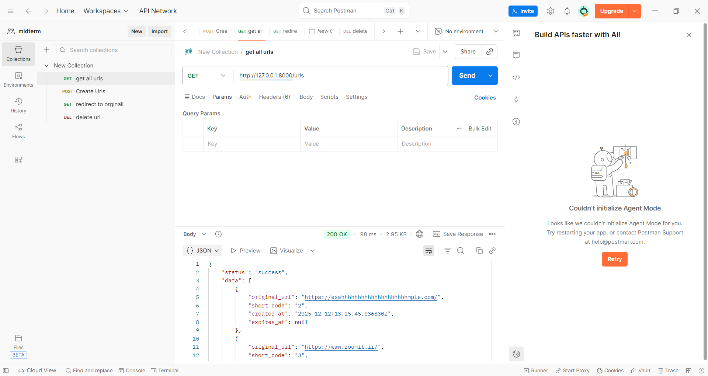
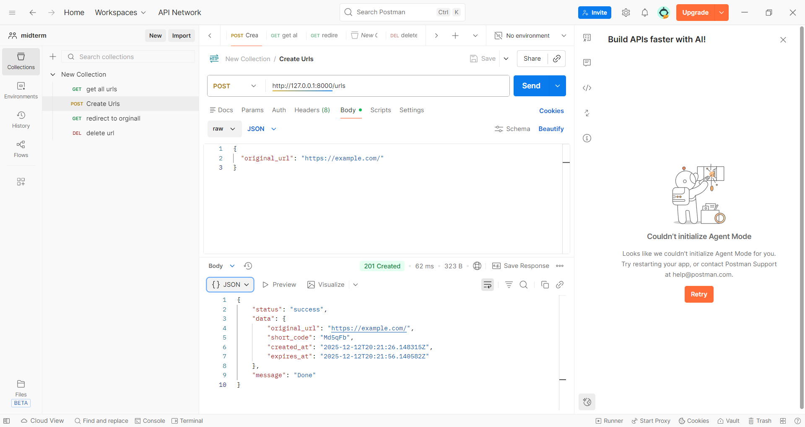
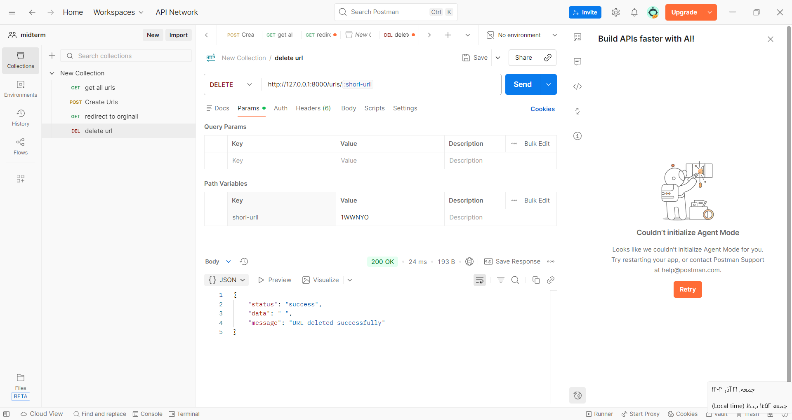
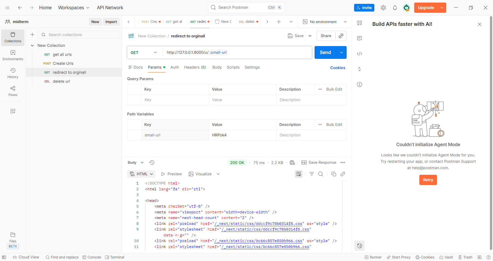
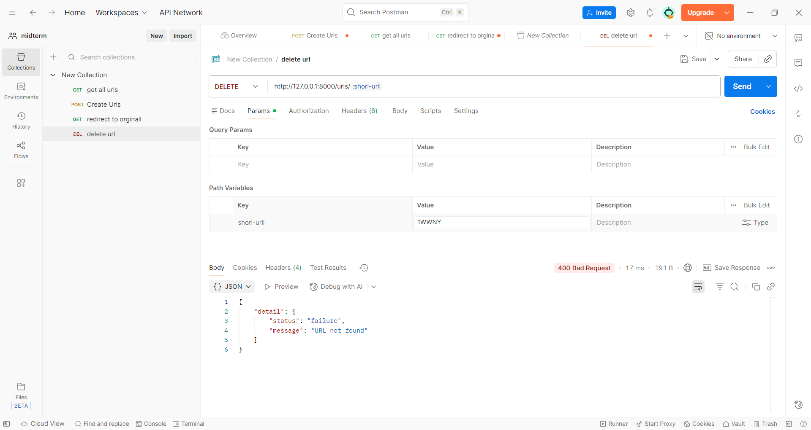
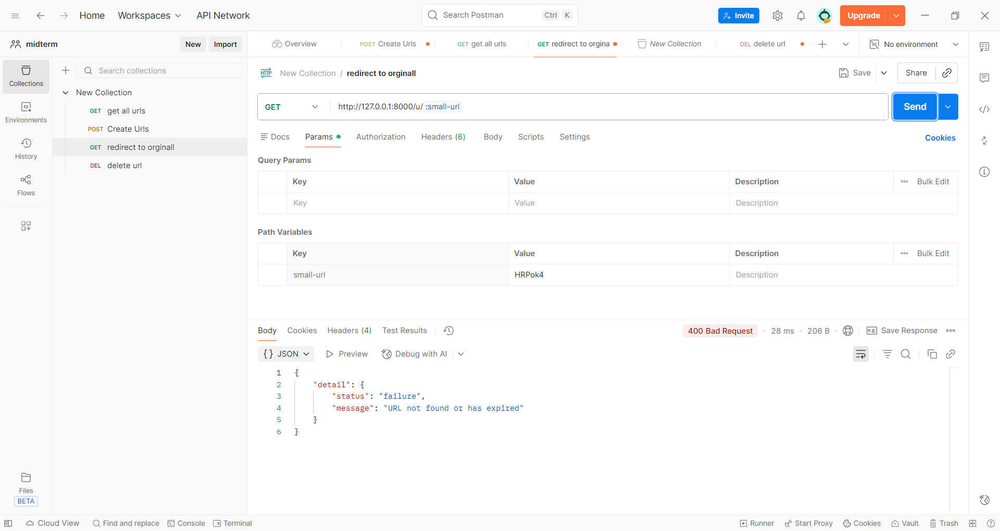

# 📘 README - Midterm Final Checklist (URL Shortener Project)

---

## ۱. API Test Coverage Table

| # | API Endpoint / Feature | Implemented & Tested By (Student Name) |
|---|------------------------|----------------------------------------|
| ۱ | Create Short Link - **POST /links** | Abolfazl                               |
| ۲ | Redirect to Original URL - **GET /{code}** | Mohamad Josein                         |
| ۳ | Get All Shortened Links - **GET /links** | Abolfazl                               |
| ۴ | Delete Short Link - **DELETE /links/{code}** | Mohamad Hosein                         |
---

## ۲. Code Generation Method (Section 6.4)
Check the method you used to generate the short code:

- [x] **۱. Random Generation**
- [ ] **۲. ID → Base62 Conversion**
- [ ] **۳. Hash-based Generation**
(Only select the one you actually implemented.)
---

## ۳. Bonus User Story: TTL (Expiration Time) for Shortened Links)
If you implemented the bonus user story, mark the box and complete the required details.

- [x] **TTL Feature Implemented**

**If checked, fill in the following information:**

- **ENV variable or config key used:**
  `LINK_TTL_SECONDS=400`
  *(This key exists in `.env.example` with a sample value.)*

- **Location of TTL Logic (File + Function):**
  Specify the exact location where TTL expiration is checked and expired links are detected/removed.

  **TTL Check (Read/Redirect):** `app/services/service.py` → `get_original_url()`
  
  **TTL Cleanup (Write/Delete):** `app/services/service.py` → `cleanup_expired_links()`

- **How TTL cleanup is triggered:**
  You must write a Command that removes expired links (created_at + TTL < now()).
  
  Here, write:

  | Field | Detail |
  | :--- | :--- |
  | Full file path of the command | `app/controller/controller.py` |
  | Command name / execution method | `POST /admin/cleanup` (API Endpoint) |
  | Scheduler details | Cleanup is triggered by an external scheduler (e.g., system **Cron Job** or a dedicated cloud service) sending a **scheduled POST request** to the `/admin/cleanup` endpoint. |

---

## ۴. Postman Collection (Required)
A **Postman Collection** has been created and includes all four API routes:

- **POST /links**
- **GET /{code}**
- **GET /links**
- **DELETE /links/{code}**

### Screenshots (included in GitHub)
For each route, two screenshots have been added:
- Successful response 
- 
- 
- 
- 
- Error-handled response 
- 
- 

